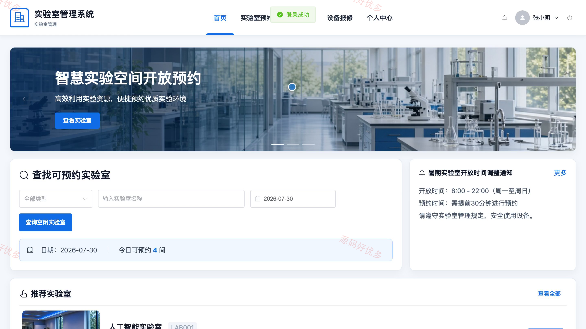
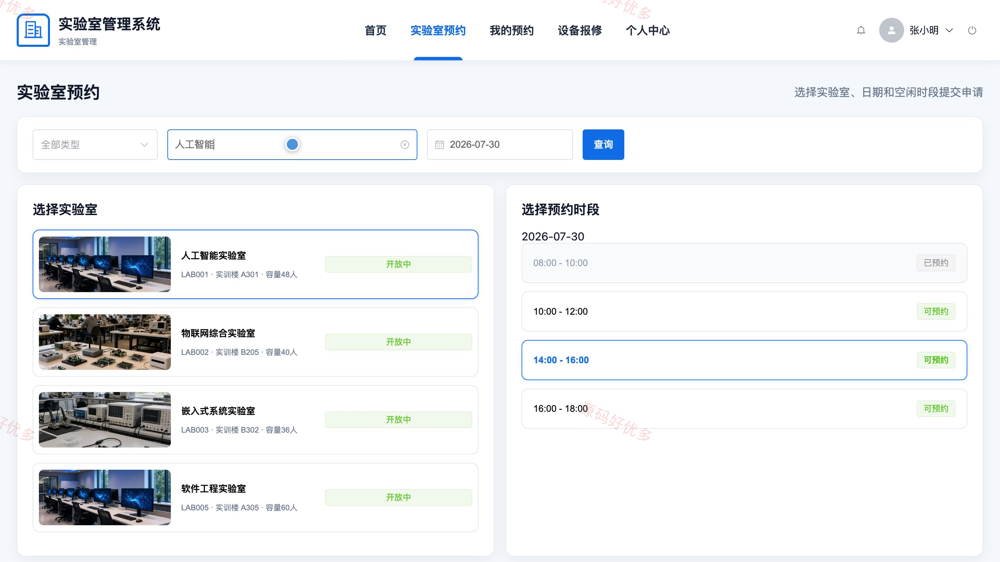
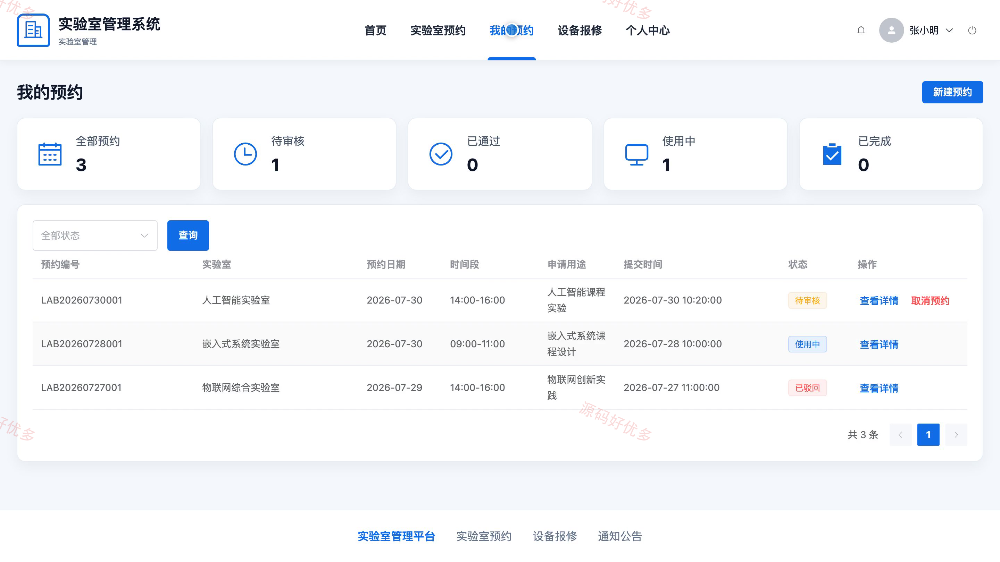
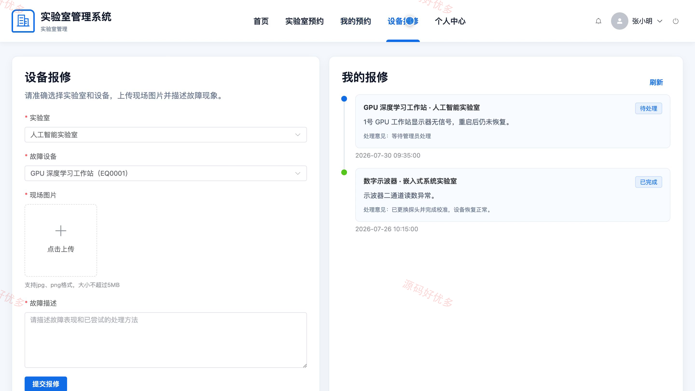
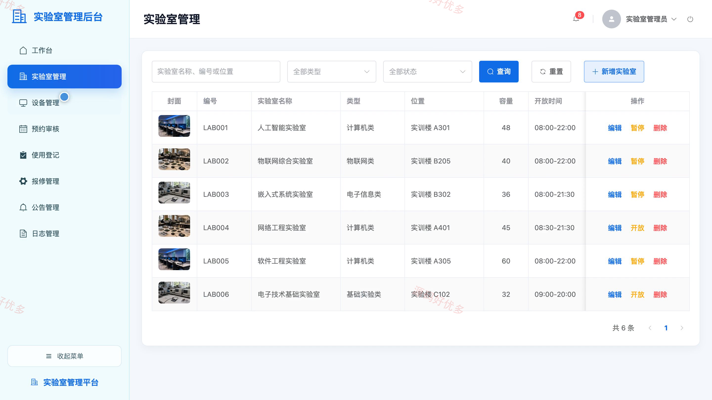
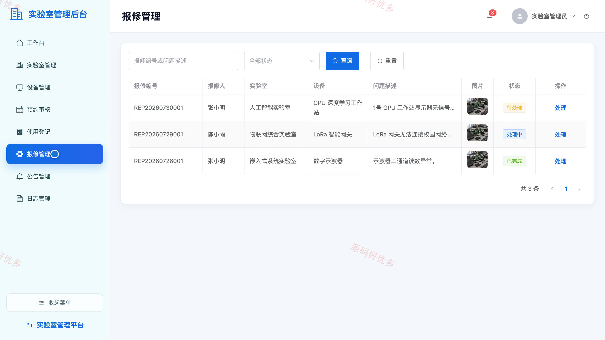
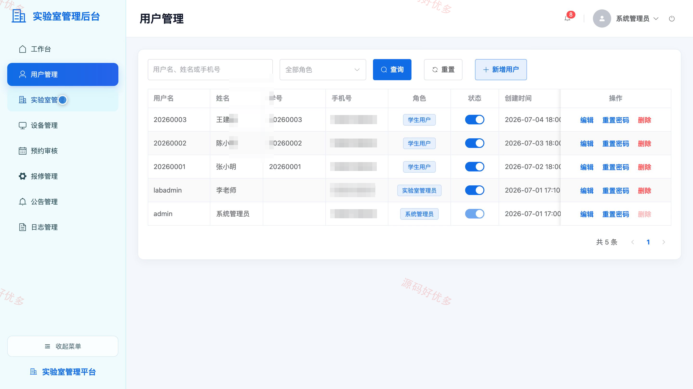

## 源码问题查看主页咨询

### 一、关键词
实验室预约、设备台账、预约审核、使用登记、设备报修、通知公告

### 二、作品包含
源码+数据库+万字设计文档+PPT+全套环境和工具资源+本地部署教程

### 三、项目技术
前端技术： Html、Css、Js、Vue3.4、Element-Plus
后端技术：Python、Django

### 四、运行环境要求
开发工具：PyCharm + VSCODE

数据库：MySQL5.7+（共9张表）

数据库管理工具：Navicat10以上版本

环境配置软件： Python3+

前端Nodejs：16+

浏览器：谷歌浏览器

### 五、项目介绍
项目编号：bs009C

系统面向高校实验室日常管理，为学生提供实验室查询、预约申请、设备报修和个人信息维护，为实验室管理员和系统管理员提供实验室、设备、预约、报修、公告及日志等业务的分角色管理功能。

角色：学生、实验室管理员、系统管理员

学生功能：实验室查询与预约、我的预约管理、设备报修、通知公告查看、个人信息维护、登录密码修改。

实验室管理员功能：工作台数据查看、实验室与设备管理、预约审核、实验室使用登记、设备报修处理、公告管理、操作日志查看、个人信息维护。

系统管理员功能：工作台数据查看、用户管理、实验室与设备管理、预约审核、设备报修处理、公告管理、操作日志查看、个人信息维护。

### 六、运行截图

